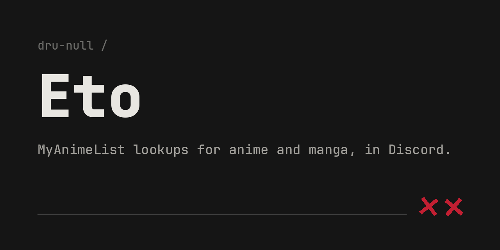
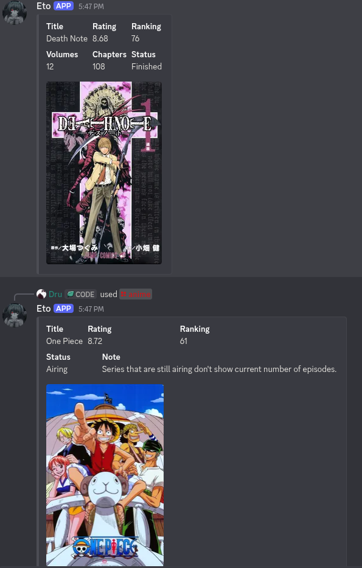

# Eto

A Discord bot for MyAnimeList lookups. Ask it about an anime or a manga, and it
replies with a card: cover, score, rank, status, and counts. Named after a
novelist who kept her real work quiet.

## Commands

| Command | What it does |
| --- | --- |
| `/anime <title>` | Looks up an anime and returns a details card |
| `/manga <title>` | Looks up a manga and returns a details card |

## Demo



## Running it yourself

**Requirements:** Python 3.10 or newer (the code uses `match`), a Discord bot
token, and a MyAnimeList API client ID.

1. Clone and enter the repo:

   ```bash
   git clone https://github.com/dru-null/Eto.git
   cd Eto
   ```

2. Create a virtual environment and install dependencies:

   ```bash
   python -m venv .venv
   source .venv/bin/activate        # Windows: .venv\Scripts\activate
   pip install -U discord.py requests python-dotenv
   ```

3. Get your credentials:

   - **Discord token:** create an application in the
     [Discord Developer Portal](https://discord.com/developers/applications),
     add a bot, enable the **Message Content** intent, and copy the token.
   - **MAL client ID:** register an app under API in your
     [MyAnimeList account settings](https://myanimelist.net/apiconfig).

4. Copy `.env.example` to `.env` and fill in both values:

   ```bash
   cp .env.example .env
   ```

   ```
   DISCORD_BOT_TOKEN=your_discord_token
   MAL_API_TOKEN=your_mal_client_id
   ```

5. Invite the bot to your server with the `applications.commands` and `bot`
   scopes, then run it:

   ```bash
   python bot.py
   ```

Slash commands sync on startup, so they may take a minute to appear the first time.

## Notes

- `.env` is gitignored. Keep your tokens out of version control; if a token ever
  lands in a commit, regenerate it rather than trying to scrub the history.
- Lookups match the closest title to your query, so partial names usually work.

## Built with

Python · [discord.py](https://discordpy.readthedocs.io/en/stable/index.html) · [MyAnimeList API](https://myanimelist.net/apiconfig/references/api/v2#section/Versioning)

<br>

<p align="right">
<picture>
  <source media="(prefers-color-scheme: dark)" srcset="https://raw.githubusercontent.com/dru-null/dru-null/main/assets/sig-dark.svg">
  <source media="(prefers-color-scheme: light)" srcset="https://raw.githubusercontent.com/dru-null/dru-null/main/assets/sig-light.svg">
  
</picture>
</p>